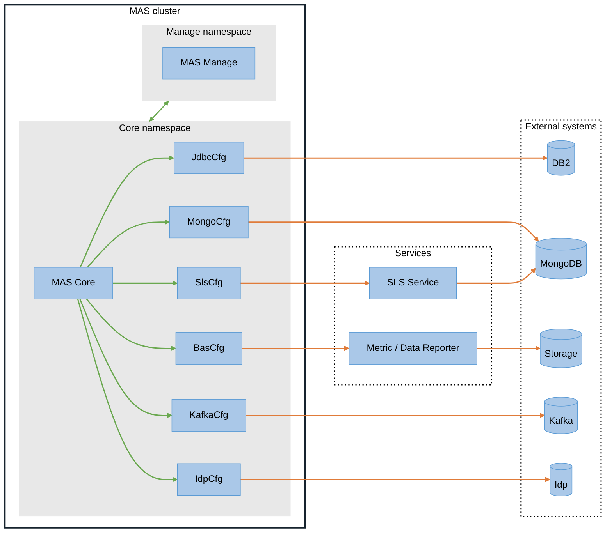

## MAS Container Installation

### Author: Jawahar

This document illustrates Operator Hub based installation of Maximo Application Suite including manual installation of all the integration components.



**Prerequisite:**

Hardware:<br>
CPU: 16 Core <br>
Memory: 64 GB Ram <br>
Disk: 1000 GB <br>

Check disk capacity [here](https://github.com/codersyacht/maximo-knowledge-center/blob/main/devops/system/disk-operations.md)

(i) MongoDB has to be installed. If not follow the instructions below to install MongoDB.<br>

[Mongo Install](https://github.com/codersyacht/maximo-knowledge-center/blob/main/devops/mongo/installation.md) <br>
[Mongo User Configure](https://github.com/codersyacht/maximo-knowledge-center/blob/main/devops/mongo/user.md) <br>
[Mongo TLS Configure](https://github.com/codersyacht/maximo-knowledge-center/blob/main/devops/mongo/tls-configuration.md) <br>

(ii) This is optional.  Oracle or DB2 has to be installed mandatorily before Maximo manage installation. This is not required for MAS suite/core. Follow the instructions below to install Oracle OR Db2. <br>

**Oracle**

[Setup](https://github.com/codersyacht/maximo-knowledge-center/blob/main/devops/oracle/setup.md)

**DB2**

[Setup](https://github.com/codersyacht/maximo-knowledge-center/blob/main/devops/db2/setup.md) <br>
[Create Dstabase](https://github.com/codersyacht/maximo-knowledge-center/blob/main/devops/db2/create-db.md) <br>
[Configure Database](https://github.com/codersyacht/maximo-knowledge-center/blob/main/devops/db2/configuration.md) <br>

(iii) OpenShift has to be installated. If no installed, follow the instructions below to install OpenShift Local. <br>

[OpenShift Local Install](https://github.com/codersyacht/maximo-knowledge-center/blob/main/devops/openshift/installation.md) <br>

### Cloning this Git Repository.

Create a git account [here](https://github.com/)
Clone this repository to begin installation.

```CMD
git clone https://github.com/codersyacht/mas-suite-install
```
username: &lt;your-git-account-userid>&gt; <br>
password: &lt;your-git-personal-access-token>&gt; <br>


### Catalog Installation

Refer to available catalpg [here](https://ibm-mas.github.io/cli/catalogs/)

Read More about Catalog Installation [here](https://github.com/codersyacht/maximo-knowledge-center/blob/main/devops/maximo/mas-suite-install%20/01-catalog-installation.md)

Navigate to mas-suite-install/01-catalogsource folder.

**Note:**
Edit the 01-ibm-operator-catalogsource.yaml file so the the right catalog is selected. The catalog used here is _v9-261105_.

Execute the following command:

```CMD
oc apply -f 01-ibm-operator-catalogsource.yaml
```

### Common Services Operators Installation

Read More about Common Service Operator Installation [here](https://github.com/codersyacht/maximo-knowledge-center/blob/main/devops/maximo/mas-suite-install%20/02-common-services-operators-installation.md)

Navigate to mas-suite-install/02-common-services

Execute the following command:

```CMD
./01-create-ibm-common-services-project.sh
```

```CMD
oc apply -f 02-ibm-common-services-operatorgroup.yaml
```

```CMD
oc apply -f 03-ibm-common-services-subscription.yaml
```
```CMD
oc apply -f 04-ibm-cert-manager-operandrequest.yaml
```

### SLS Installation

Read More about SLS Installation [here](https://github.com/codersyacht/maximo-knowledge-center/blob/main/devops/maximo/mas-suite-install%20/03-suite-license-service-installation.md)

**Prerequisite**

Create IBM Entitlement Key [here](https://myibm.ibm.com/products-services/containerlibrary) if you do not have an ibm entitlement key. <br>

Update the /keyfiles/ibm-entitlement-key with the IBM entitlement key before executing the below commands.

Ensure to copy the mongoDB certificate to a new file named mongo.crt under /keyfiles/. (./keyfiles/mongo.crt). Replace if it exists. Read more about Mongo security [here](https://github.ibm.com/maximo-application-suite/knowledge-center/blob/main/devops/mongo/Mongo-Enable-SSL-TLS.md) <br>
Note thr MongoDB user name and password. <br>

Navigate to mas-suite-install/03-sls directory.

**Setup Initialization**

Execute the following commands:

```CMD
00-ibm-sls-install-init.sh
```

**SLS Operator Installation**

```CMD
./01-create-ibm-sls-project.sh
```

```CMD
./02-ibm-sls-entitlement.sh
```

```CMD
oc apply -f 03-ibm-sls-operatorgroup.yaml
```

```CMD
oc apply -f 04-ibm-sls-subscription.yaml
```

**SLS Installation**

```CMD
./05-ibm-sls-mongo-credentials.sh
```

```CMD
oc apply -f 06-ibm-sls.yaml
```

Optional

```CMD
./07-patch-sls-startupprobe.sh
```


### Data Reporter Installation

Read More about Data Reporrter Installation [here](https://github.com/codersyacht/maximo-knowledge-center/blob/main/devops/maximo/mas-suite-install%20/04-mas-operator-installation.md)

Navigate to mas-suite-install/04-data-reporter.

Execute the following commands:

```CMD
./01-create-ibm-software-central-project.sh
```

```CMD
02-ibm-metric-entitlement-key.sh
```

```CMD
oc apply -f 03-ibm-metrics-operatorgroup.yaml
```

```CMD
oc apply -f 04-ibm-metrics-subscription.yaml
```

```CMD
oc apply -f 05-ibm-marketplaceconfig.yaml
```

```CMD
oc apply -f 06-ibm-data-reporter-subscription.yaml
```

### Maximo Application Suite Installation

Read More about MAS Operator Installation [here](https://github.ibm.com/maximo-application-suite/knowledge-center/blob/main/devops/maximo/mas-suite-install/04-mas-operator-installation.md)

**Prerequisite**

Ensure to obtain the sls registration key and the sls certicicate. You can follow the instruction [here](https://github.com/codersyacht/maximo-knowledge-center/blob/main/devops/maximo/mas-suite-install%20/05-mas-slscfg.md) to obtain the same. There should 2 files as follows under /mas-suite-install/keyfiles directory each containing the values accordingly.

- sls-registration-key
- sls.crt

Update the two files.

Ensure to copy the mongoDB certificate to a new file named mongo.crt under /keyfiles/. (./keyfiles/mongo.crt). Replace if it exists. Read more about Mongo security [here](https://github.ibm.com/maximo-application-suite/knowledge-center/blob/main/devops/mongo/Mongo-Enable-SSL-TLS.md) <br>
Note thr MongoDB user name and password. <br>
Note the Db2 user name and password. <br>


Navigate to mas-suite-install/04-mas-init

**Setup Initialization**

```CMD
./00-mas-install-init.sh
```

**MAS Operator Installation**

Execute the following commands.

```CMD
./01-create-ibm-mas-project.sh
```

```CMD
./02-ibm-mas-entitlement-key.sh
```

```CMD
oc apply -f 03-ibm-mas-operatorgroup.yaml
```

```CMD
oc apply -f 04-ibm-mas-subscription.yaml
```

**Install MAS SlsCfg**

Read More about MAS SlsCfg Installation [here](https://github.com/codersyacht/maximo-knowledge-center/blob/main/devops/maximo/mas-suite-install%20/05-mas-slscfg.md)

Execute the following command:

```CMD
./05-mas-sls-registration-key.sh
```

```CMD
oc apply -f 06-slsCfg.yaml
```

**Install MAS MongoCfg**

Read More about MAS MongoCfg Installation [here](https://github.com/codersyacht/maximo-knowledge-center/blob/main/devops/maximo/mas-suite-install%20/06-mas-mongocfg.md)

Execute the following command:

```CMD
./07-ibm-mas-mongo-credentials.sh
```

```CMD
oc apply -f 08-MongoCfg.yaml
```

**Install MAS JdbcCfg**

This segment should only be executed if prerequisite ii was done. Otherwise this section can be skipped. But this has to be executed before installing mas manage.

Read More about MAS JdbcCfg Installation [here](https://github.com/codersyacht/maximo-knowledge-center/blob/main/devops/maximo/mas-suite-install%20/07-mas-jdbc.md)

Execute the following command:

```CMD
./09-ibm-mas-jdbc-credentials.sh
```

```CMD
oc apply -f 10-JdbcCfg.yaml
```

**Maximo Application Suite Core Installation**

Read More about Maximo Application Suite Installation [here](https://github.com/codersyacht/maximo-knowledge-center/blob/main/devops/maximo/mas-suite-install%20/08-mas-install.md)

Execute the following commands:

```CMD
oc apply -f 11-MasInstall.yaml
```
