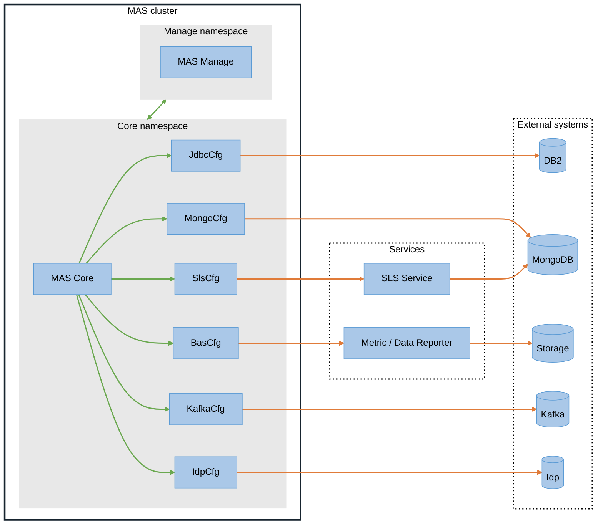

## MAS Container Installation

### Author: Jawahar

This document illustrates Operator Hub based installation of Maximo Application Suite including manual installation of all the integration components.

**Disclaimer:** This not official IBM documentation. It is only meant for self learning.



**Prerequisite:**

Hardware:<br>
CPU: 16 Core <br>
Memory: 64 GB Ram <br>
Disk: 1000 GB <br>

Check disk capacity [here](https://github.com/codersyacht/maximo-knowledge-center/blob/main/devops/system/disk-operations.md)

(i) MongoDB has to be installed. If not follow the instructions below to install MongoDB.<br>

[Mongo Install](https://github.com/codersyacht/maximo-knowledge-center/blob/main/devops/mongo/installation.md) <br>
[Mongo User Configure](https://github.com/codersyacht/maximo-knowledge-center/blob/main/devops/mongo/user.md) <br>
[Mongo TLS Configure](https://github.com/codersyacht/maximo-knowledge-center/blob/main/devops/mongo/tls-configuration.md) <br>

(ii) This is optional.  Oracle or DB2 has to be installed mandatorily before Maximo manage installation. This is not required for MAS suite/core. Follow the instructions below to install Oracle OR Db2. <br>

**Oracle**

[Setup](https://github.com/codersyacht/maximo-knowledge-center/blob/main/devops/oracle/setup.md)

**DB2**

[Setup](https://github.com/codersyacht/maximo-knowledge-center/blob/main/devops/db2/setup.md) <br>
[Create Dstabase](https://github.com/codersyacht/maximo-knowledge-center/blob/main/devops/db2/create-db.md) <br>
[Configure Database](https://github.com/codersyacht/maximo-knowledge-center/blob/main/devops/db2/configuration.md) <br>

(iii) OpenShift has to be installated. If no installed, follow the instructions below to install OpenShift Local. <br>

[OpenShift Local Install](https://github.com/codersyacht/maximo-knowledge-center/blob/main/devops/openshift/installation.md) <br>

### Cloning this Git Repository.

Clone this repository to begin installation.

```CMD
git clone https://github.com/codersyacht/mas-suite-install
```

## Understanding

- All the **Read More about** is only to understand more about the files being executed. There is no need to create sh or yaml files. All required files are made available in the repository.
- All the 00 files are for dynamic preparation of the yaml files.
- Place the the ibm entitlement key in the folder keyfiles/ibm-entitlement-key. Otherwise installation will fail.

### Catalog Installation

Refer to available catalpg [here](https://ibm-mas.github.io/cli/catalogs/)

Read More about Catalog Installation [here](https://github.com/codersyacht/maximo-knowledge-center/blob/main/devops/maximo/mas-suite-install%20/01-catalog-installation.md)

Navigate to mas-suite-install/01-catalogsource folder.

**Note:**
Edit the 01-ibm-operator-catalogsource.yaml file so the the right catalog is selected. The catalog used here is _v9-261105_.

Execute the following command:

```CMD
oc apply -f 01-ibm-operator-catalogsource.yaml
```

### Certificate Manager Operator Installation

Read More about Certificate Manager Operator Installation [here](https://github.com/codersyacht/maximo-knowledge-center/blob/main/devops/maximo/mas-suite-install%20/02-cert-manager-operator-installation.md)

Navigate to mas-suite-install/02-cert-manager

Execute the following command:

```CMD
./01-create-cert-manager-project.sh
```

```CMD
oc apply -f 02-cert-manager-operatorgroup.yaml
```

```CMD
oc apply -f 03-cert-manager-subscription.yaml
```

### SLS Installation

Read More about SLS Installation [here](https://github.com/codersyacht/maximo-knowledge-center/blob/main/devops/maximo/mas-suite-install%20/03-suite-license-service-installation.md)

**Prerequisite**

If Mongodb is installed using the reference installation documentation mentioned here and if the installation path and the certificate path are exactly same, executing the 00-ibm-sls-install-init.sh file will take care of the following. Otherwise, the following steps has to be executed.

**IBM Entitlement Key**

Create IBM Entitlement Key [here](https://myibm.ibm.com/products-services/containerlibrary) if you do not have an ibm entitlement key. <br>

Update the /keyfiles/ibm-entitlement-key with the IBM entitlement key before executing the below commands.

**Mongo Certificate**

Ensure to copy the mongoDB certificate to a new file named mongo.crt under /keyfiles/. (./keyfiles/mongo.crt). Replace if it exists. Read more about Mongo security [here](https://github.com/codersyacht/maximo-knowledge-center/blob/main/devops/mongo/tls-configuration.md) <br>
Note thr MongoDB user name and password. <br>

Navigate to mas-suite-install/03-sls directory.

**Setup Initialization**

**Note:**
If Mongodb is installed using the reference installation documentation mentioned here and if the installation path and the certificate path are exactly same, executing the 00-ibm-sls-install-init.sh file will take care of updating the yaml file with the right certificate. If this manually performed the following 00-ibm-sls-install-init.sh need not be executed.

Execute the following commands:

```CMD
./00-ibm-sls-install-init.sh
```

**SLS Operator Installation**

```CMD
./01-create-ibm-sls-project.sh
```

```CMD
./02-ibm-sls-entitlement.sh
```

```CMD
oc apply -f 03-ibm-sls-operatorgroup.yaml
```
**Note:** 
Edit the 04-ibm-sls-subscription.yaml file so the the right version is selected. Version used here is ibm-sls.v3.13.3.

```CMD
oc apply -f 04-ibm-sls-subscription.yaml
```

**SLS Installation**

```CMD
./05-ibm-sls-mongo-credentials.sh
```

**Note:**
Ensure the right mongodb certificate and the hostname is rightly used in 06-ibm-sls.yaml.

```CMD
oc apply -f 06-ibm-sls.yaml
```

### Data Reporter Installation

Read More about Data Reporrter Installation [here](https://github.com/codersyacht/maximo-knowledge-center/blob/main/devops/maximo/mas-suite-install%20/04-mas-operator-installation.md)

Navigate to mas-suite-install/04-data-reporter.

Execute the following commands:

```CMD
./01-create-ibm-software-central-project.sh
```

```CMD
./02-ibm-metric-entitlement-key.sh
```

```CMD
oc apply -f 03-ibm-metrics-operatorgroup.yaml
```

**Note:**

Edit the versions in the 04-ibm-metrics-subscription.yaml & 04-ibm-metrics-subscription.yaml acordingly. The used version here is v2.24.11.

```CMD
oc apply -f 04-ibm-metrics-subscription.yaml
```

```CMD
oc apply -f 05-ibm-marketplaceconfig.yaml
```

```CMD
oc apply -f 04-ibm-metrics-subscription.yaml
```

### Maximo Application Suite Installation

Read More about MAS Operator Installation [here](https://github.com/codersyacht/maximo-knowledge-center/blob/main/devops/maximo/mas-suite-install%20/04-mas-operator-installation.md)

**Prerequisite**

The following need to performed if Mongodb and database are not installed based on the instructions in this article or if the folder structures has changed.

**SLS**

Ensure to obtain the sls registration key and the sls certicicate. You can follow the instruction [here](https://github.com/codersyacht/maximo-knowledge-center/blob/main/devops/maximo/mas-suite-install%20/05-mas-slscfg.md) to obtain the same. There should 2 files as follows under /mas-suite-install/keyfiles directory each containing the values accordingly.

- sls-registration-key
- sls.crt

Update the two files.

**MongoDB**

Ensure to copy the mongoDB certificate to a new file named mongo.crt under /keyfiles/. (./keyfiles/mongo.crt). Replace if it exists. Read more about Mongo security [here](https://github.com/codersyacht/maximo-knowledge-center/blob/main/devops/mongo/tls-configuration.md) <br>
Note thr MongoDB user name and password. <br>
Note the Db2 user name and password. <br>


Navigate to mas-suite-install/05-mas-init

**Setup Initialization**

**Note:**

- Extracts the SLS certificate to ../keyfiles/sls.crt.
- Extracts the SLS registration key to ../keyfiles/sls-registration-key.
- Updates 06-sls-cfg.yaml with the SLS URL and the SLS certificate.
- Updates 08-mongo-cfg.yaml with the hostname and the Mongo certificate from ../keyfiles/mongo.crt.
- Populates the JDBC URL in 10-jdbc-cfg-db2.yaml and 10-jdbc-cfg-oracle.yaml.
- Sets the domain in 15-masinstall.yaml to the hostname.

```CMD
./00-mas-install-init.sh
```

**MAS Operator Installation**

Execute the following commands.

```CMD
./01-create-ibm-mas-project.sh
```

```CMD
./02-ibm-mas-entitlement-key.sh
```

```CMD
oc apply -f 03-ibm-mas-operatorgroup.yaml
```

**Note:**
Update the 04-ibm-mas-subscription.yaml to use the appropriate version. The version used here is v9.2.10.

```CMD
oc apply -f 04-ibm-mas-subscription.yaml
```

**Install MAS SlsCfg**

Read More about MAS SlsCfg Installation [here](https://github.com/codersyacht/maximo-knowledge-center/blob/main/devops/maximo/mas-suite-install%20/05-mas-slscfg.md)

Execute the following command:

```CMD
./05-mas-sls-registration-key.sh
```

```CMD
oc apply -f 06-sls-cfg.yaml
```

**Install MAS MongoCfg**

Read More about MAS MongoCfg Installation [here](https://github.com/codersyacht/maximo-knowledge-center/blob/main/devops/maximo/mas-suite-install%20/06-mas-mongocfg.md)

Execute the following command:

```CMD
./07-ibm-mas-mongo-credentials.sh
```

```CMD
oc apply -f 08-mongo-cfg.yaml
```

**Install MAS JdbcCfg**

This segment should only be executed if prerequisite ii was done. Otherwise this section can be skipped. But this has to be executed before installing mas manage.

Read More about MAS JdbcCfg Installation [here](https://github.com/codersyacht/maximo-knowledge-center/blob/main/devops/maximo/mas-suite-install%20/07-mas-jdbc.md)

Execute the following command for Oracle:

**Oracle**

```CMD
./09-ibm-mas-jdbc-credentials-oracle.sh
```

```CMD
oc apply -f 10-jdbc-cfg-oracle.yaml
```
Execute the following command for DB2:

**DB2**

```CMD
./09-ibm-mas-jdbc-credentials-db2.sh
```

```CMD
oc apply -f 10-jdbc-cfg-db2.yaml
```

**Cluster Role Settings**

```CMD
oc apply -f  11-clusterissuer.yaml
```

```CMD
oc apply -f 12-cluster-role-core-coreapi.yml
```

```CMD
oc apply -f 13-cluster-role-core-entitymgr-suite.yml
```

```CMD
oc apply -f 14-cluster-role-core-internalapi.yml
```

**Maximo Application Suite Core Installation**

Read More about Maximo Application Suite Installation [here](https://github.com/codersyacht/maximo-knowledge-center/blob/main/devops/maximo/mas-suite-install%20/08-mas-install.md)

**Note:**
Ensure the domain name is rightly set.

Execute the following commands:

```CMD
oc apply -f 15-masinstall.yaml
```

## Conclusion

Post installation, all the routes will be available in the OpenShift Routes. Access the MAS admin and login with super user. Super user credentials will be avialable in the mas suite namespace secrets.
